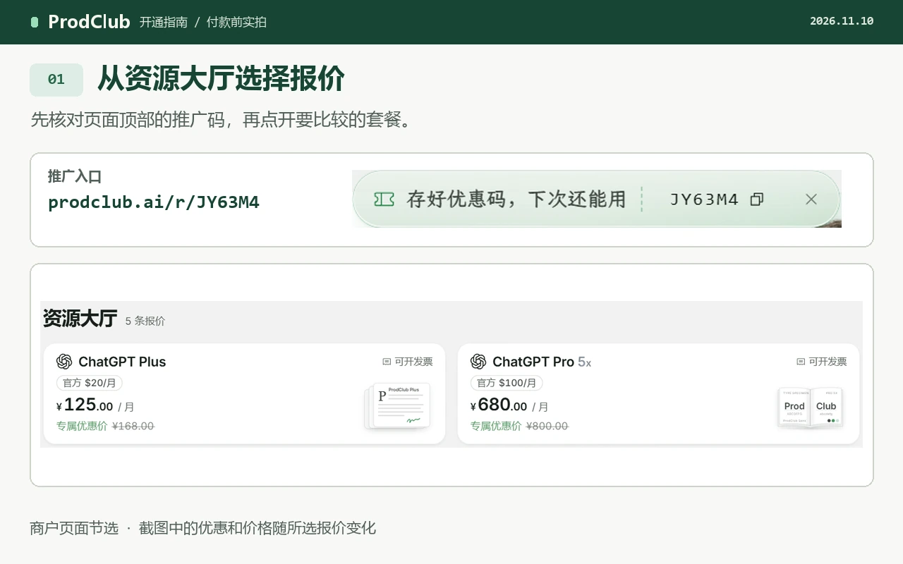
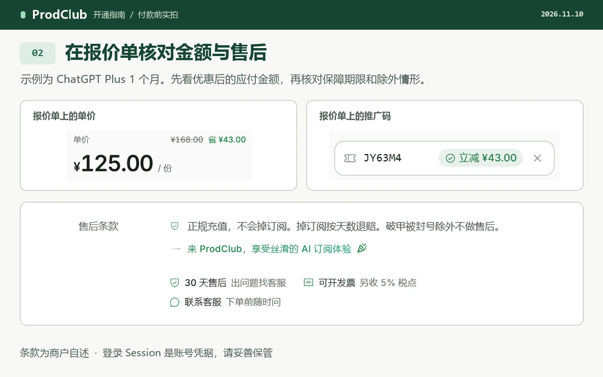

# ProdClub · ChatGPT Plus / Pro 开通指南

想用支付宝给自己的 ChatGPT 账号开通会员，可以先在 ProdClub 看对应套餐的报价。跟着下面的图文走一遍，就能找到优惠价、确认开通条件，并知道付款后去哪里查订单。

> **[打开 ProdClub 优惠入口][prodclub-offer]**　推广码 <code data-promo-code>JY63M4</code>

本指南由 RottenToTheBone 独立维护。我们是推广者，通过链接成交可能获得奖励。商品、收款和售后由第三方商户 ProdClub 提供。[阅读网页版](https://rottentothebone.github.io/chatgpt-subscription-guide/)

## 视频教程

第一次使用，可以先看网页中的操作演示，再回来对照图文。演示里的价格和商品库存可能随时变化。[观看开通演示](https://rottentothebone.github.io/chatgpt-subscription-guide/#video)

## 图文教程

### 第一步 · 准备自己的账号和邮箱

先登录你打算升级的 ChatGPT 账号，记下当前套餐。再准备一个能收邮件的邮箱，商户会把订单链接发到这里。已经开过会员的话，先检查原订阅的到期日和续费状态，避免为同一段时间重复付款。[支持的国家和地区](https://help.openai.com/en/articles/7947663-chatgpt-supported-countries) · [查看已有订阅](guides/payment-and-renewal.md)

网络访问可以用这个注册入口先开一下（我常用）： 
[FlowerCloud 注册入口][network-offer]（推广链接）

### 第二步 · 打开优惠入口，选择报价

1. **[打开 ProdClub 优惠入口][prodclub-offer]。** 检查地址栏里的域名是 `prodclub.ai`。当前推广码是 <code data-promo-code>JY63M4</code>。选中具体商品后，再看结算金额是否已应用优惠。
2. **选 Plus 或 Pro。** 例如，要给自己的账号开一个月 Plus，就找到列明「ChatGPT Plus」和「1 个月」的报价。买 Pro 时还要核对具体档位。商品列表里的接码服务另有用途，订阅会员应选择对应的套餐报价。

3. **看清条款，再提交订单。** 在报价页对照套餐、购买期限、应付总额和售后天数。尤其留意提前失效时如何处理、退款有什么条件。填好接收订单邮件的邮箱，确认无误后再提交。

4. **到订单页付款。** 商户公开帮助列出了支付宝，部分商品另列 USDT。以这一单实际显示的付款方式和应付金额为准。支付后保留订单号和收据。如果已经扣款而页面仍在等待，先联系商户核对，避免再次扫码。[商户付款说明](https://prodclub.ai/help)
5. **注意账号凭据。** 商户说明，自有账号开通在付款后会要求提交 ChatGPT Session。这是一段能让持有者以你的身份访问账号的登录凭据。请在决定付款前了解这一要求。希望自己保管登录凭据的用户，可以直接选择官方订阅。[ChatGPT 官方套餐](https://chatgpt.com/pricing/)
6. **确认开通成功。** 先看原订单的处理结果，再回到自己的 ChatGPT 账号，在设置中核对套餐。若订单显示完成，账号仍是原套餐，先核对登录账号，再带上订单号向商户查询。订单邮件请自己保存。

## 订单帮助与 Codex 重置雷达

忘了订单页地址，可以先在下单邮箱里搜索 ProdClub。付款进度、退款和售后问题看商户帮助；要查 Codex 额度重置相关公告，商户另设了雷达页面。[ProdClub 帮助中心](https://prodclub.ai/help) · [Codex 重置雷达](https://prodclub.ai/radar)

## 常见问题

**什么是 Session？交给商户安全吗？** Session 是登录后的会话凭据，拿到的人可能以你的身份访问账号。商户的自有账号报价要求付款后交一次 Session，希望只由自己保管凭据的读者可以选择官方订阅。[商户说明](https://prodclub.ai/help) · [官方套餐](https://chatgpt.com/pricing/)

**掉订阅和账号封禁都在售后范围内吗？** 商户将订阅提前失效与账号封禁分别处理。购买前看具体报价的保障期限、赔付方式和除外条件，不能从“有售后”推断账号一定不会受限。[商户售后说明](https://prodclub.ai/help)

**代充、成品号和合租有什么区别？** 自有账号代充会把订阅开到你现有的账号上，买成品号会拿到卖家交付的另一个账号，合租则是多人共用一个账号。需要保留自己原有对话时，先核对报价的交付方式。[报价与订单核对指南](guides/prodclub-referral.md)

**哪些账号可以开？什么情况要等到期？** 商户当前的 Plus 月度报价要求账号为免费版，已有 Plus 无法通过该报价提前叠加。Pro 5x 月度报价接受免费账号或已有菲区 Plus 的账号，其他地区 Plus 按商户帮助说明要等到期后再买。[Plus 报价](https://prodclub.ai/offers/chatgpt-plus-1m) · [Pro 5x 报价](https://prodclub.ai/offers/chatgpt-pro-5x-1m)

**“菲区”指什么？** 商户用这个词标记经菲律宾地区渠道开通的订阅，现有订阅的地区会影响能否通过指定报价升级。你所在地区能否使用 ChatGPT，请另查 OpenAI 公布的国家和地区列表。[商户说明](https://prodclub.ai/help) · [OpenAI 支持地区](https://help.openai.com/en/articles/7947663-chatgpt-supported-countries)

**可以开发票吗？** 商户帮助页写明，需选择带“可开发票”标记的报价，开通后联系商户办理。商户目前说明会另收开票金额的 5%，需要报销时请在付款前确认总成本。[商户开票说明](https://prodclub.ai/help)

**开通要等多久，失败后怎么办？** 商户将通常处理时间写为 1 至 2 分钟，额外验证或人工处理可能更久。已扣款却一直没有结果，请保留订单号向 ProdClub 查询，尚未开通时，也可查看原订单是否显示退款按钮。[商户开通与退款说明](https://prodclub.ai/help)

**推广码能便宜多少？可以用微信吗？** 通过[优惠入口][prodclub-offer]选定商品后，再对比同档、同期限的最终金额。商户帮助页列出的人民币支付方式为支付宝，其他方式请以该订单的付款页为准。[商户付款说明](https://prodclub.ai/help)

**Plus 和 Pro 怎么选？** 每周读一些文件、做几次编程任务，可以先看 Plus。已有套餐多次在同一类任务上碰到限额，再比较 Pro 各档给这种任务增加了多少用量。[Plus 与 Pro 选购指南](guides/compare-plans.md)

## 关于 ProdClub

ProdClub 提供 ChatGPT 自有账号订阅代充等服务，报价页列出交付方式和售后条款，订单页用于跟进开通进度。本仓库由独立推广者维护，订单查询和退款请联系实际收款的商户。[ProdClub 帮助中心](https://prodclub.ai/help)

资料核对日期为 2026 年 11 月 10 日。如果商户界面或规则有变化，欢迎附上公开页面反馈；私人订单请直接联系商户。[提交资料更正](https://github.com/RottenToTheBone/chatgpt-subscription-guide/issues)

维护推广入口

修改 `site-config.js` 后，运行 `node tools/partner.cjs` 同步 README 和网页，再运行 `npm ci`、`npm run build`。教程截图和视频记录了当时的报价与推广码，换码时应一并更新实拍素材。

[prodclub-offer]: https://prodclub.ai/r/JY63M4
[network-offer]: https://api-flowercloud.com/aff.php?aff=27706
