

  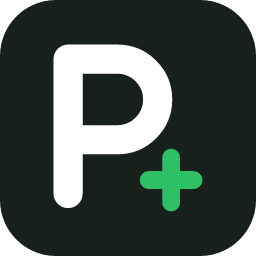

<h1 align="center">ProdClub</h1>

让每一笔 AI 资源交易，都更直接、透明、可信。

<i>愿有一天，信息不再有围墙，知识不再有距离。</i>

---

最好的 AI 已经来了，但很多人被挡在一张信用卡外面。

ProdClub 想做的事很简单：
把这道墙拆掉，让你用支付宝，把 ChatGPT 会员开到**自己的账号**上。

不卖号，不合租，不做没法质保的生意。
只把一件小事，做到足够好。

**ProdClub：做产品的人做的代充。只接能质保的单，开通进度实时可见，没开通随时退。**

**ProdClub 提供售后，质保与升级退差价按各报价的条款办理。**

> 优惠开通：[ProdClub / JY63M4](https://prodclub.ai/r/JY63M4)

# ProdClub · GPT 订阅开通指南

**如果你需要使用 GPT，但手里没有用来支付订阅费用的信用卡**

**那这篇教程可以解决你的问题！！**

## 宣传视频

[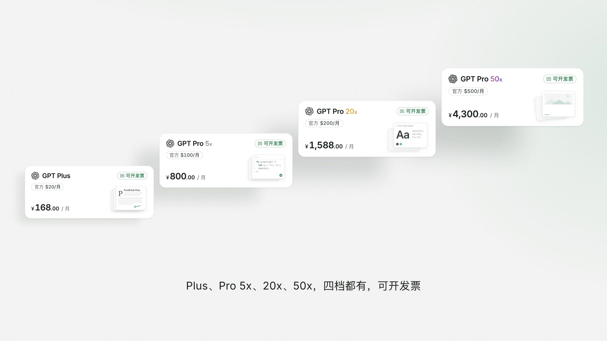](https://rottentothebone.github.io/chatgpt-subscription-guide/videos/prodclub-film.mp4)

**ProdClub 宣传片** · [1080p](https://rottentothebone.github.io/chatgpt-subscription-guide/videos/prodclub-film.mp4) · [4K](https://rottentothebone.github.io/chatgpt-subscription-guide/videos/prodclub-film-4k.mp4)

[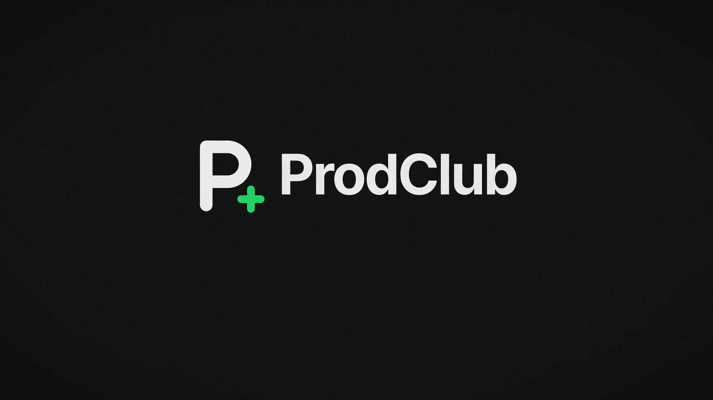](https://rottentothebone.github.io/chatgpt-subscription-guide/videos/prodclub-teaser.mp4)

**ProdClub 预告片** · [1080p](https://rottentothebone.github.io/chatgpt-subscription-guide/videos/prodclub-teaser.mp4) · [4K](https://rottentothebone.github.io/chatgpt-subscription-guide/videos/prodclub-teaser-4k.mp4)

## 图文教程

**废话不多说，教程开始**

## 第一步：准备资料

首先你需要自己准备一个自己的账号，勿买卖他人账号。

需能正常访问 ChatGPT 官网，具体网络环境请自行依法合规解决，本文不讨论。

网络访问可以用这个注册入口先开一下（我常用）：

https://api-flowercloud.com/aff.php?aff=27706

注册后按需选择套餐：装好客户端 → 选个节点连上 → 能打开 ChatGPT 官网即可。后面再按需续。

## 第二步：开通

#### 打开专属优惠链接，注意使用优惠码 JY63M4

https://prodclub.ai/r/JY63M4

打开后，你看到的是这个界面就对了「注意：升级我们是能给你退差价的，一定要联系客服」

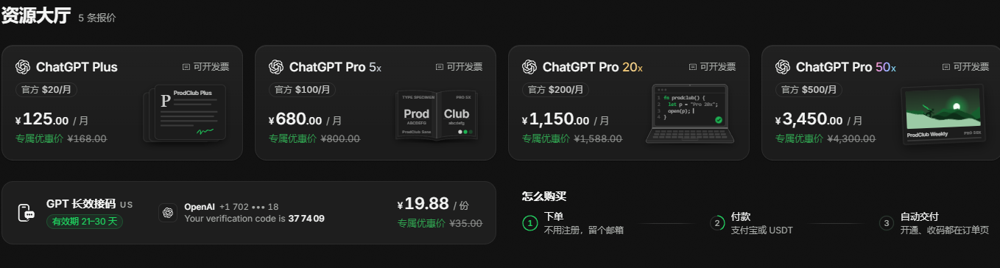

#### 2.选择你需要的，以 Pro 5x 为例

例子中是原始价格

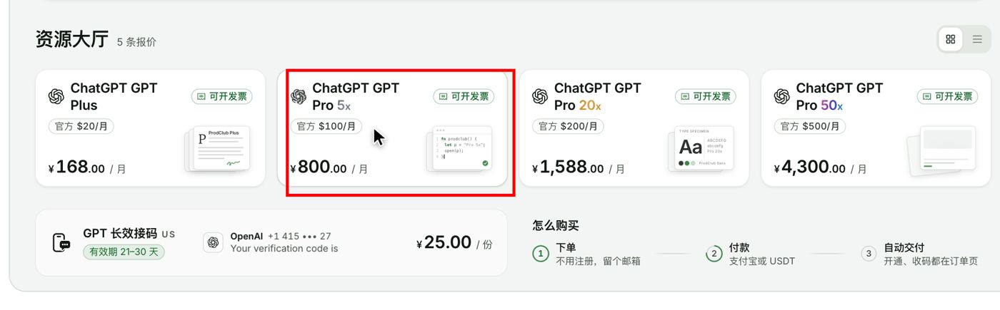

#### 3.提交

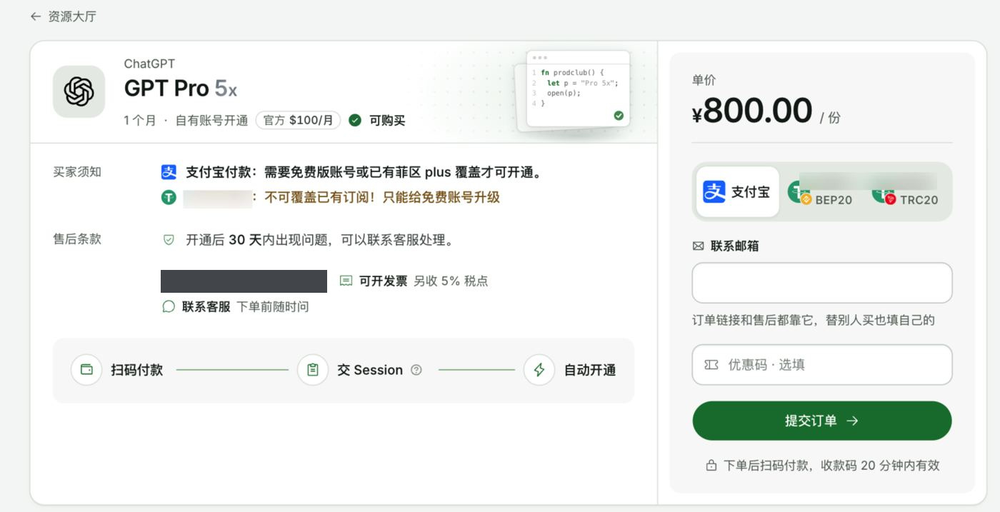

注意这里的售后条款

一定要填入你的邮箱，用于接收订单号，也可以作为一个凭证，用于售后

然后点提交

#### 4.付款

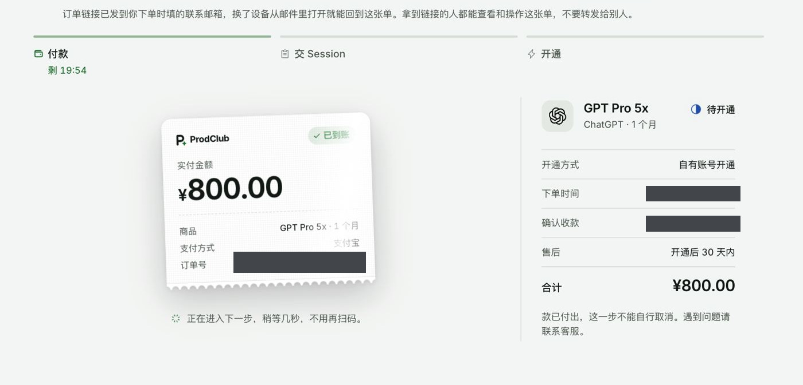

#### 5. 账号确认

核对要开通的账号。Session 是登录凭据，请勿转交。

#### 6.开通成功

会出现检查账号页面，稍等一下就好，出现这个页面就是完全开通了，去看下自己的账号是不是已经有了会员。

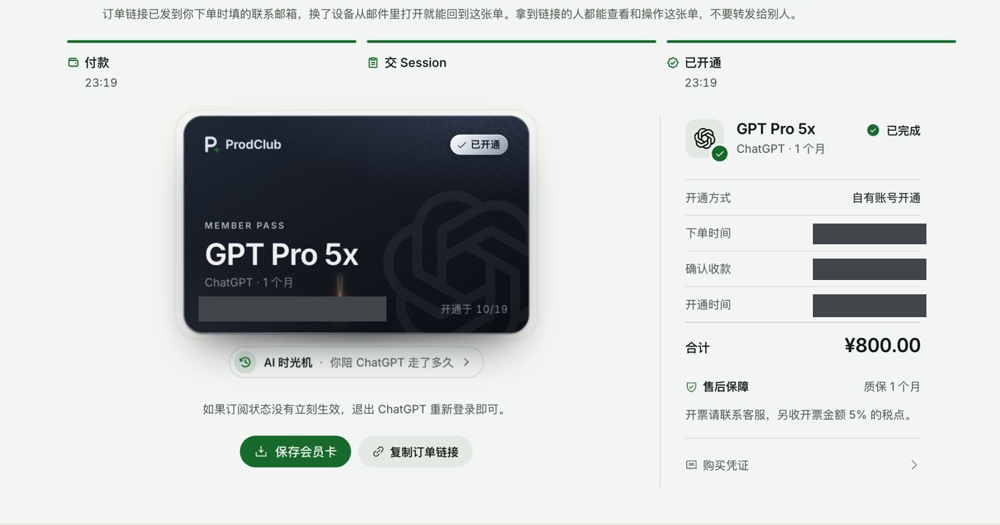

## 答疑：

如果你有其他疑问可以直接去帮助查看

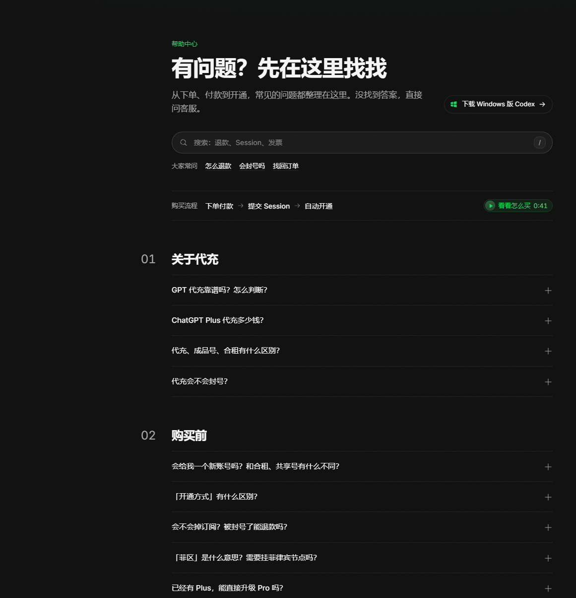

## 重置雷达

OpenAI 会不定期把所有付费用户的 Codex 额度重置一次，或者发一张重置卡。这里盯着公告，有消息就更新。

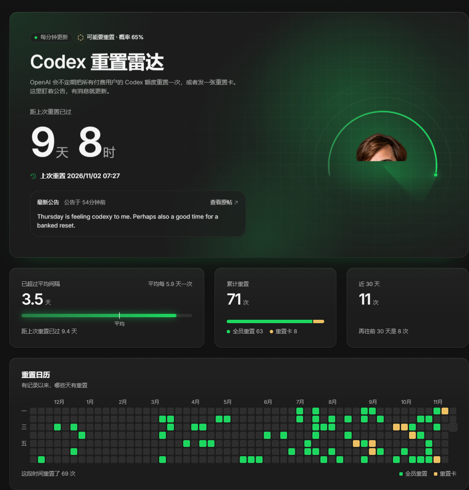

## 答疑：

### 代充会不会封号？

账号状态以 OpenAI 的实际处理为准。

封号多半和用法有关：用越狱提示词（俗称「破甲」）等违反 OpenAI 使用条款的方式、一个账号几个人共用。这类原因导致的封号不在售后范围内。

订阅本身在售后期内掉了，带上订单号联系客服，按报价的「售后条款」处理。

### 什么是 Session？

Session 是登录凭据，持有者可能以你的身份访问账号。

### GPT 代充靠谱吗？怎么判断？

代充就是请别人替你付 ChatGPT 的订阅费。靠不靠谱，看三件事：

- 充到哪个账号：我们开通到你自己的 ChatGPT 账号上，不给新号、不和别人共用，聊天记录和设置都还在。
- 要不要密码：请保管好自己的密码和登录凭据。
- 出了问题找谁：每条报价写明售后天数，售后期内掉了订阅按「售后条款」处理；付了款还没开通、不想要了，订单页上可以申请退款。

不用注册，支付宝扫码付款，开通结果实时显示在订单页上。

### 代充、成品号、合租有什么区别？

三种都能用上 ChatGPT 会员，差别在账号是谁的：

- 代充：会员开通到你自己的账号上。账号、聊天记录、设置都是你的，到期了接着续。我们做的是这一种。
- 成品号：卖家给你一个已经开好会员的新账号。原来账号里的聊天记录用不上，注册信息不在你手里，可能被原注册人找回。
- 合租：几个人共用一个会员账号。聊天记录彼此看得到，用量大家一起分，一人违规可能连累整个号。

在意隐私、要长期用的，代充最省心。

### 「开通方式」有什么区别？

报价上会写明开通方式：

- 自有账号开通：开通到你自己的 ChatGPT 账号。
- 接码：Codex 专用，给你一个美国 +1 号码，用来收 Codex 的短信验证码。

### 「菲区」是什么意思？需要挂菲律宾节点吗？

- 「菲区」指充值走的是菲律宾地区，开通后的订阅和在官网直接订阅没有区别。
- 使用地区以 [ChatGPT 支持的国家和地区](https://help.openai.com/en/articles/7947663) 为准。

### 可以开发票吗？

- 带「可开发票」标记的报价可以开。开通成功后联系客服开票，另收开票金额 5% 的税点。没有这个标记的报价暂时不能开票。

### 开通要多久？没开通成功怎么办？

通常一两分钟，结果会自动显示在订单页，不用刷新。途中偶尔需要你完成一次安全验证，按页面提示做完，开通会自动继续。

开通没成功时，回订单页查看原因；需要售后时可凭订单号联系客服。

### 可以开的号

1. 免费账号（现在没有订阅）：Plus、Pro 都能开。
2. 菲区（菲律宾区付费）的 Plus，可以直接升级到 Pro，不用等到期。升级后联系客服可以退 Plus 的差价，原来的 Plus 不是在这里买的也可以退。（ 走 USDT 付款不能升级 Pro，只能免费账号开）

### 暂时开不了的号

1. 已经有订阅，还想开 Plus：Plus 只能开在免费账号上，不能叠加，也不能提前续。等现在的订阅到期、账号变回免费版再买。
2. 其他地区付费的 Plus 想升级 Pro：比如美区。只有菲区的订阅能升级，其他地区的要等到期。
3. 已经是 Pro，而且档位不低于要买的：没有更高的档位可以升级。
4. iOS（App Store）订阅到期后苹果可能还有一段宽限期（一般 72h），这段时间账号显示免费版也开不了，要等宽限期结束。
5. 团队 / 企业账号（Team、Business、Enterprise）：开不了个人订阅，请换个人账号。

## 关于 ProdClub

ProdClub 由一群做互联网产品的人发起。我们发现，GPT 代充这个行业最大的问题不是价格，而是不透明：不知道充到哪、出了问题找不到人、页面看着就不靠谱。

所以我们按做产品的标准来做这件事：

- 少即是多：没法质保的业务一律不接，宁可少卖
- 过程透明：开通进度在订单页实时显示，不用等客服回消息
- 规则写在前面：售后天数、能开和不能开的号，下单前就讲清楚

我们希望 ProdClub 成为你身边那个“问了就知道靠谱”的名字。

[ProdClub 客服](https://prodclub.ai/help)

  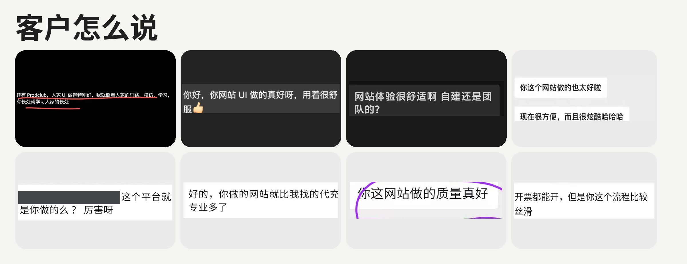

